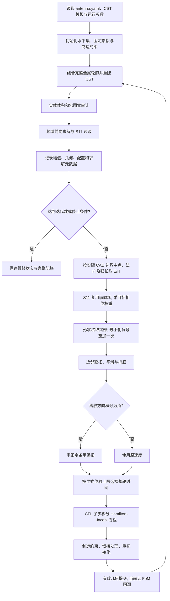

# 天线 S11 震荡：完整检测、调整与服务器复现报告

日期：2026-11-15。本文是本轮工作的统一入口。已合并并删除重复的阶段报告，保留数学推导、公共接口说明、开源参考和运行手册；早期其它案例的独立证据另保留于综合测试分析报告。原始实验数据与检测脚本继续保留。

## 1. 结论与证据强度

现有证据支持多个因素共同影响天线优化，尚未找到能够解释全部反弹的单一根因。

| 猜测的原因 | 检测证据 | 调整方式及当前状态 | 可以得出的结论 |
|---|---|---|---|
| 整轮更新过大，超出局部线性范围 | 固定总时间八步最大预测移动 9.7586 mm，网格间距仅 0.2 mm；4/8 步下降，最终幅值升高 | 天线增加显式 `--max-step-mm 0.1`，逐轮按当前最大速度限制总时间；两次八步分别 6/8、5/8 步下降 | 是整体趋势的重要影响因素；仍有反弹，未证明是唯一根因 |
| 水平集到 CAD 的小扰动不一致 | 初始对齐矩形内缩趋零时仍产生约 0.141421 mm 角点误差；规定长度扰动存在约 0.04 mm² 面积误差下限 | 修复重复重初始化漂移、过度简化、坐标输出精度；研究保留 CAD、三角形单元提取路线 | 部分漂移已修复；角点处的一阶一致性仍未解决，单纯缩小时间步不能保证消除 |
| 延拓、插值、平滑反转方向 | 非均匀圆周独立反例中方向积分由 +0.12650009 变成 −0.01813854 | 增加方向检查，负值才启用半正定备用延拓，反例修复为 +0.01776052 | 存在潜在算法缺陷；**实际保存的 28 次更新全部未触发备用延拓**，不能据此解释这些轨迹的反弹 |
| 生产公式的相位、共轭、符号或归一化错误 | 44 个解析 Maxwell S 元素核对；实际八状态中生产密度与同场单高度归一化密度正比例等价，最大相对 L2 残差 1.50e-15 | 核对目标权重只施加一次、最小化负号只施加一次，保留双线性场乘积 | 未发现支持 S11 专用反号或经验倍率的证据；不等于真实边界场与电磁差分已经闭合 |
| 单高度代替完整侧壁积分 | 初始天线单层密度与多高度求积密度加权 L2 差约 6.46%–7.10%，两个规定方向均未翻号 | 增加多高度/偏移诊断接口，生产仍采用原单高度路径 | 影响幅值，但本组证据不支持其是整体反号的主要原因 |
| 电项与磁项抵消放大误差 | 初始长度/宽度方向抵消比约 7.15 / 6.63 | 保存分项贡献，避免仅凭总量或局部点判断 | 可能放大取场误差；不是 S11 独有性的证明，也不足以解释数量级差异 |
| 极小几何变化触发不同离散响应 | 两个近似相同轮廓 Hausdorff 距离约 1.15e-7 mm，幅值相差约 0.07379；完全相同轮廓重复的幅值极差仅 3.67e-8 | 加入相同 CAD 重建复算、实体体积/包围盒审计、输入与网格哈希 | 需要继续分离几何与离散求解影响；不能笼统说“CST 的场不准”或“同一输入随机漂移” |
| 每个有效几何均被提交 | 上限试验中的反弹照常进入后续状态；最终值高于最佳中间值 | 当前没有增加 FoM 拒绝/回溯 | 会把坏步传播到后续迭代；它是接受策略的局限，不是坏步产生原因的独立证明 |

当前通过的是有限八步运行中的“整体下降、多数步骤改善”指标。尚未证明严格单调、长期收敛、局部导数与实际电磁差分定量一致，也未证明任意 S 参数器件都有效。

## 2. 当前数学公式与时间尺度

采用金属内部 φ<0、法向由金属指向外部的约定。目标 F=|S_mn|，前向端口 n，互易伴随端口 m。在 PEC、固定端口、匹配的互易模态及一致的峰值相量约定下：

\[
\delta F = \operatorname{Re}\!\left[
\frac{\overline{S_{mn}}}{|S_{mn}|}
\frac{-j\omega}{4A_f A_a}
\int_{\Gamma}\left(\epsilon E_{n,f}E_{n,a}
+\mu\mathbf H_{t,f}\cdot\mathbf H_{t,a}\right)\delta n\,dA
\right].
\]

场乘积不取复共轭；目标的复链式因子含共轭。这里 A_f、A_a 是与端口反应归一化一致的入射幅值，不是未经条件限定的任意功率代换。S11 在当前互易同端口实现中复用前向场。S=0 时幅值目标不可微，代码拒绝未定义相位。

对沿 z 挤出的侧壁，令 δn_i=hν_i，则完整离散一阶预测为

\[
\Delta F_{\rm pred}(h)=\frac{10^{-9}h_{\rm mm}}{4A_f A_a}
\operatorname{Re}\!\left[-j\omega\frac{\overline S}{|S|}
\sum_i\sum_k(\epsilon E_{n,f}E_{n,a}
+\mu\mathbf H_{t,f}\cdot\mathbf H_{t,a})_{ik}
\nu_i w_i w_{z,k}\right].
\]

w_i、w_z 和 h 均按 mm 计，所以体积因子为 10^-9。二维求和是侧壁的弧长与厚度求积；每一点的位移乘上了相应导数密度和面积权重，与 δF=Σ_i(∂F/∂x_i)δx_i 一致。实际有限变化还含高阶余项。

生产单频路径仍使用中高度、外偏移场的 `shape_derivative_mine`，目标权重 `−jω conj(S)/|S|` 在取实部前施加。它给出原始速度尺度，不能直接当作归一化 FoM 变化。当前天线 t=0.018 mm、P_inc=0.5 W 的同场常厚度核对满足

\[
g_{\rm normalized,mid}=\frac{10^{-9}t_{\rm mm}}{4P_{\rm inc}}
g_{\rm production}=9\times10^{-12}g_{\rm production}.
\]

这仅是该归一化和单高度近似下的代数关系。改变正比例会改变固定时间步的实际移动，不能直接换系数后宣称有限更新行为等价。

HJ 方程为 ∂tφ+V|∇φ|=0。CFL 负责每个 PDE 子步稳定，不能限制全部子步合计的形变。天线上限试验采用

\[
\Delta t_k=\min\left(10^{-8},\frac{0.1\ {\rm mm}}{\|V_k\|_\infty}\right),
\qquad \Delta t_k\|V_k\|_\infty\le0.1\ {\rm mm}.
\]

每轮从原始时间重新计算。上限约束的是网格速度预测移动，制造处理和 CAD 提取后的实际最大边界移动未获同样保证。

“以前已经减小时间步，为何仍震荡”：固定较小时间不控制逐轮变化的最大速度；即使移动变小，真实下降所需邻域也随状态改变。若真实 DF[V]<0 且余项受二阶界约束，足够小的正时间可下降；当前实际 CAD 映射、场近似和差分噪声仍未满足这一整套认证条件。减小时间不能自动修复导数误差或非零几何误差下限。

## 3. 已做的代码调整与验证

| 代码位置 | 调整目的与实现 | 检测结果/边界 |
|---|---|---|
| `adjoint_levelset.py`：`LevelSet.reinit` | FMM/EDT 后，对跨界网格边的连通组施加共同正比例，保留线性零交点及原零节点 | 重复重初始化漂移消除；接口附近不保证精确距离，也未解决所有角点提取问题 |
| 同文件：`boundary_to_grid_velocity`、`_positive_boundary_velocity` | 对原近邻/归一化高斯延拓回采样后检查方向积分；负值才采用伴随散射与对称平滑 | 独立反例通过；实际 28 步均沿原延拓路径 |
| 同文件：`OptimizerConfig.max_step_mm`、优化循环 | 正有限上限校验，逐轮按 vmax 限制总时间；默认 None | 真实平面 HJ 位移测试、默认行为与非法输入测试通过；没有改变目标接受规则 |
| `eaopt/geometry/design.py` | 按实际 CAD 的边和外法向做弧长中点求积；制造过滤只修改分类变化节点；保留区外固定金属与馈接 | 修复采样几何错配和额外栅格化漂移；约束投影仍可能改变给定线性位移 |
| 同文件：天线轮廓导出 | 简化容差 1e-9 mm；停止为满足点数预算而放宽几何误差；后续取消天线经验点数上限 | 实体检查已验证超过旧 400 点预算的轮廓可构建；其他案例保留原预算 |
| `eaopt/solver/cst_model.py` | CAD 坐标输出采用 17 位有效数字 | 避免 6 位输出导致边界再次移动 |
| `eaopt/solver/cst_model_antenna.py`、`cst.py`、`scripts/cst_update.py` | 天线重建后读取实际实体体积/包围盒；与预期面积×厚度核对；拒绝陈旧审计文件 | 三条最新天线八步轨迹各九次审计通过；不是局部曲面精度和电磁网格收敛认证 |
| `eaopt/runner.py` | 仅天线入口提供 `--max-step-mm`，仅用于 levelset 路线，冻结参数到运行记录 | 其它入口不暴露该实验参数；未将其设为全局默认 |
| `eaopt/geometry/state.py`、`evolution.py` | 独立保留 CAD 状态、边界力到顶点速度的度量映射、设计域约束、碰撞检查 | 独立参考和单步电磁检查有进展，但后续遇到窄空气间隙取场问题；没有成为最新成功八步轨迹的更新路线 |
| `eaopt/geometry/implicit.py` | 研究三角形单元/单元扇区提取及匹配重初始化 | 仍是实验路线，不能当作生产角点问题已解决 |
| `scripts/check_*`、`tests/` | 独立 Maxwell 参照、几何趋零、相同 CAD 复算、厚度求积、存档延拓重放及回归 | 保存脚本、输入、结果与测试；未通过的物理/几何门槛在本文保留 |

备用延拓的离散证明：令 q 已含优化方向符号，R 为网格到边界的双线性取样，W 为弧长权重，D 为带宽/设计掩膜，G 为对称高斯卷积，则

\[
V=\frac1{\Delta x}DGG^TDR^TWq,
\quad q^TWRV=\frac1{\Delta x}\|G^TDR^TWq\|^2\ge0.
\]

实现使用同一双线性权重的转置散射、两次 sigma/√2 卷积及掩膜。该保证只针对计算密度的离散方向积分，不保证逐点速度同号、最终 CAD 位移方向或有限 FoM 下降。

11 月 9 日的出射功率系数和旧磁场核实验属于历史对照。当前保留的核为 εE_nE_n+μH_t·H_t，没有给磁项再乘 jω；没有采用拟合 S11 差分的倍率。早期小时间步实验与当前核、端口模板不同，不能直接合并为同一次控制实验。

## 4. 最新实际轨迹：全部状态与反弹均保留

数据目录分别为 `results/antenna_hj_audited_2026-11-15`、`results/antenna_hj_capped_2026-11-15`、`results/antenna_hj_capped_repeat_2026-11-15`。

| 状态 | 原固定时间 | 上限 0.1 mm 第一轮 | 上限 0.1 mm 独立重复 |
|---:|---:|---:|---:|
| 0 | 0.54631250 | 0.54631276 | 0.54631293 |
| 1 | 0.26053584 | 0.28326017 | 0.23415414 |
| 2 | 0.61063419 | 0.26430277 | 0.21163523 |
| 3 | 0.95197304 | 0.18060921 | 0.20532981 |
| 4 | 0.90907029 | 0.18130781 | 0.24706479 |
| 5 | 0.96268452 | 0.12252937 | 0.18888384 |
| 6 | 0.95620561 | 0.07321848 | 0.05314746 |
| 7 | 0.89815016 | 0.17172501 | 0.07426583 |
| 8 | 0.93547208 | 0.10345757 | 0.20366426 |

- 原固定时间：4/8 步下降，净增加 0.38915958，最大预测移动 9.758621922 mm。
- 上限第一轮：6/8 步下降，最终降低 81.06%；第 4、7 步反弹。
- 上限重复轮：5/8 步下降，最终降低 62.72%；第 4、7、8 步反弹。
- 两轮上限轨迹每轮预测移动均为 0.1 mm；所有有效更新照常提交。最佳中间值没有冒充最终值。两条数值轨迹不逐点相等。


实际存档延拓重放覆盖上述 24 步及耦合器/功分器各两步：全部原方向积分为正，备用延拓 0/28 次。归一化方向余弦范围：原天线 0.770–0.970，上限第一轮 0.539–0.968，重复轮 0.892–0.968，耦合器 0.971–0.999，功分器 0.992–0.993。这是计算方向的对齐证据，不是物理梯度准确性的度量。

其它案例当前短程回归：

| 案例 | 本次实际两步 | 原两步终值 | 本次终值相对原终值 |
|---|---|---:|---:|
| 耦合器，最大化 S31 幅值 | 0.09281816 → 0.14940987 → 0.30706913 | 0.30995156 | −0.9300% |
| 功分器，最大化 S21 幅值 | 0.66405637 → 0.67754607 → 0.69053161 | 0.68553994 | +0.7281% |

两例使用默认总时间 1e-8、上限关闭，冻结配置与原基线相同，均两步改善。这支持短程行为保留，不代表长期效果或数值严格相等。

## 5. 当前天线算法框架



上限没有显式传入时 O 使用原固定总时间。S_mn 中 m≠n 的案例在同一几何上异步启动 fwd/bwd，等待两者成功后收集场，后续复用该 bwd 解。并行调度不改变梯度公式。

## 6. 服务器复现步骤

### 6.1 环境与迁移

当前 CST 调用依赖已安装的 CST 官方 Python link；本地使用 CST 2024 和 Python 3.10。服务器需安装兼容的 CST、Python link、许可证及项目依赖。下列 PowerShell 命令面向兼容的 Windows CST 环境，未在 Linux 服务器上验证。不要直接复制本机 `.venv`。

```powershell
python -m pip install -e .
# 把路径替换为服务器实际 CST 安装目录
python -m pip install --no-index --find-links 'C:\Program Files (x86)\CST Studio Suite 2024\Library\Python\repo\simple' cst-studio-suite-link
python -m unittest discover -s tests
python scripts/run_antenna_adjoint_levelset.py --help
```

若官方 link 自动定位失败，可在当前 PowerShell 会话将 `$env:PYTHONPATH` 指向服务器实际的 `<CST安装目录>\AMD64\python_cst_libraries` 后检查 `import cst.interface, cst.results`。本次整理时本机安装缺少 `E:\CST2024\Image_Version`，显式设置路径仍不能完成官方导入；这属于服务器迁移前需独立确认的环境项，不能靠测试桩解决真实求解。

迁移整个源码目录中的 `adjoint_levelset.py`、`eaopt/`、`scripts/`、`configs/`、`tests/`、`pyproject.toml` 和本文；如需离线核对本地证据，再迁移 `results/`。`results/` 被 Git 忽略，仅推送代码不会带走这些数据。本次复现指纹见同目录 `antenna_reproduction_manifest_2026-11-15.json`，包含源码/配置哈希、冻结运行记录哈希和环境版本。当前工作区含尚未提交的修复，不能仅按旧 Git 提交号复现。

### 6.2 优先复现同样八步，再延长

使用三个新的空输出目录运行，勿把上一轮终态当下一轮起点：

```powershell
# 当前代码、原固定时间基线
python scripts/run_antenna_adjoint_levelset.py configs/antenna.yaml --new --solver fd --boundary-sampling cst-points --adjoint-source objective --geometry-update levelset --iterations 8 --output-dir results/server_antenna_fixed

# 显式开启整轮移动上限
python scripts/run_antenna_adjoint_levelset.py configs/antenna.yaml --new --solver fd --boundary-sampling cst-points --adjoint-source objective --geometry-update levelset --iterations 8 --max-step-mm 0.1 --output-dir results/server_antenna_cap

# 完全独立重复
python scripts/run_antenna_adjoint_levelset.py configs/antenna.yaml --new --solver fd --boundary-sampling cst-points --adjoint-source objective --geometry-update levelset --iterations 8 --max-step-mm 0.1 --output-dir results/server_antenna_cap_repeat

# 两工程并行的短程其它案例回归
python scripts/run_coupler_adjoint_levelset.py configs/coupler.yaml --new --iterations 2 --output-dir results/server_coupler
python scripts/run_divider_adjoint_levelset.py configs/divider.yaml --new --iterations 2 --output-dir results/server_divider
```

命令按案例逐个执行；每个异端口案例内部的 fwd/bwd 已并行，无需临时 `patch(_run_solvers, serial)` 包装。`eaopt/solver/cst.py::_run_solvers` 先异步启动全部工程，再等待成功；启动/求解失败会停止本次已启动的其它求解。相关调度测试覆盖启动顺序、失败停止和后向结果复用。**天线 S11 仍只求 fwd，这是当前同端口算法所需行为。**

当前天线关键配置：设计框 [−20,20]² mm；初始贴片 [−20,0]×[−10,10] mm；左侧固定馈接；dx=0.2 mm；最小特征 0.6 mm；外侧偏移 0.05 mm；z=0.009 mm；金属厚度 0.018 mm；7.5 GHz；基本总时间 1e-8；CFL=0.5。材料、端口和网格设置还应逐字段对比 `run_config.json` 的 `setup` 与服务器输出；dx 是水平集网格，不代表固定的 CST 四面体网格。

### 6.3 核对标准

1. 首先核对服务器与本地配置、模板和版本，记录求解器与机器差异；初始幅值本地约 0.546313，偏差明显时先查初始模型而非调梯度倍率。
2. 每条八步轨迹应有初始加八次候选评估、相应几何审计及完整历史。检查 `run_config.json`、`adjoint_levelset_history.jsonl`、`cst_evaluations.jsonl`、`iter_*/native_geometry_fwd.json`、`final_shape.json`。
3. 上限路径逐轮核对 `pseudo_time_step_used * vmax` 与 `predicted_displacement` 一致且不超过 0.1 mm；统计下降步数、最终相对变化、最佳中间值及反弹位置，分别报告。
4. 本地仅支持多数步改善和整体下降，不能预设服务器每一步数值相等。两次本地上限轨迹已存在显著差异；没有预先认证的逐点数值容差。
5. 先完成上述对照，再用新的输出目录把上限试验改为 `--iterations 30` 检查长期趋势，保存所有反弹。延长迭代目前属于待执行检查。

## 7. 下一轮真正需要区分的问题

优先冻结一个反弹起点，例如第一上限轮状态 6（0.07321848），保持同一场、同一边界密度及同一网格速度，分别用 0.1、0.05、0.025、0.0125 mm 预测移动求候选。每个候选都从同一基态产生，不逐次累积，也不重算方向。同步检查零操作 CAD、实际边界移动/对称差面积、制造处理前后差异与实际 FoM。

| 观察 | 更支持的解释 |
|---|---|
| 大移动升高，小移动稳定下降 | 有限更新超出局部下降邻域 |
| 名义移动趋零，实际 CAD 差异不趋零 | 几何提取/投影误差下限 |
| CAD 位移一致且趋零，实际差分仍稳定反号 | 优先检查该状态的物理密度、取场与归一化 |
| 同向差商随微扰不稳定，但同 CAD 复算稳定 | 几何与离散求解耦合敏感性，需继续分离 |

这项反弹状态的电磁步长扫描尚未执行。其它候选如 Hilbert/H1 延拓、完整厚度生产接入及 FoM 回溯仍是后续方案，未作为此次复现默认行为。

## 8. 证据索引与中间产物清理

| 内容 | 记录 |
|---|---|
| 完整上限试验、其它案例回归 | `results/antenna_hj_capped_2026-11-15/combined_validation.json`，本文第 4 节 |
| 原 HJ、相同 CAD 复算、生产密度等价 | `results/antenna_exact_repeat_20261115T015925/results.json`，`results/antenna_hj_audited_2026-11-15/production_density_equivalence.json` |
| 实际 28 步延拓重放 | `results/extension_sign_replay_2026-11-15.json` |
| 几何误差下限与独立反例 | `results/algorithm_validation_2026-11-13/results.json`，`results/hj_geometry_consistency_2026-11-15/` |
| 通用 S 矩阵推导与独立 Maxwell 参照 | [数学推导](pec_smatrix_derivation_2026-11-12.md)，`results/pec_cylinder_smatrix_2026-11-12/results.json` |
| 厚度求积与电磁项抵消 | [公共接口说明](sidewall_density_interface_2026-11-14.md)，`results/antenna_thickness_density_20261115T021909/` |
| 保留 CAD 路线的约束与失败边界 | `results/antenna_cad_trend_2026-11-14/`，本文第 3、9 节 |
| 开源路线及冻结源码出处 | [开源调查](levelset_open_source_review_2026-11-15.md)，`results/levelset_research_2026-11-15/manifest.json` |

产物清理范围：`results/**/cst_work/` 与根目录 `_viz/` 内可重新导出的 E/H ASCII 场文本，以及项目 Python 缓存。保留全部 NPZ 场、φ、逐轮 CAD、网格证据、CST 工程、运行日志、配置、检测源码和参考源码。另清理已经被本文覆盖的阶段报告；删除文件的名称、哈希与原证据链接记录到清理记录的 `report_cleanup` 字段。

删除清单、文件数和释放字节见 [清理记录](antenna_cleanup_2026-11-15.json)。被清理的 ASCII 场可由保留的 CST 工程重新导出；若要运行依赖这些原始文本的历史检查，需先重新导出。当前存档延拓重放依赖的 NPZ 与 φ 均保留。

本次实际清理 875 个文件/缓存目录，共 8,035,024,445 字节（约 7.48 GiB）。清理后重新执行 `check_saved_extension_sign.py` 成功，完整 28 步存档重放仍通过。

本次离线回归 91 项通过：由于当前官方 CST 库导入失败，调用前仅对 `cst`、`cst.interface`、`cst.results` 注入空导入模块；现有测试自行以 Mock 工程/模型检查并行启动、异常停止、结果复用和审计逻辑。这不是实际官方库调用或原生并行仿真通过。运行结果见 [离线测试记录](antenna_offline_checks_2026-11-15.json)。服务器应在真实官方库可导入的情况下重新执行上面的标准测试命令。

本次整理只进行离线测试、存档核对和清理，没有重新运行 CST 电磁仿真，也未在服务器验证实际并行资源配置。生产并行路径原已存在，本次核对后直接沿用。

## 9. 阶段报告中补充归并的结论

### HJ 网格速度与离散界面速度的区别

若提取器采用 φ_h(x,t)=Σ_j N_j(x)φ_j(t)，在插值梯度非零、无单元顶点或拓扑事件的局部区间，实际界面速度为

\[
V_{n,\mathrm{actual}}=-\frac{\sum_jN_j\dot\phi_j}{|\nabla\phi_h|},
\qquad \frac{dF}{dt}=-\int_\Gamma g\frac{\sum_jN_j\,\mathrm{RHS}_{HJ,j}}{|\nabla\phi_h|}\,ds.
\]

迎风 HJ 梯度与提取插值的梯度不同，所以直接积分 gV_grid 通常不等于这个表达式。研究性三角分片表示上的 80 组精确多项式几何目标检查未发现方向反号；隐式一致预测与中心差分最大相对误差约 2.76e-6。实际差商相对直接速度积分的比例，普通隐式场为 0.9055–1.1096，非均匀缩放场为 0.6875–1.8780。不能以固定倍率解释全部方向，也未因此认证生产天线角点和制造投影。数据在 `results/hj_geometry_consistency_2026-11-15/direction_transfer.json`，脚本为 `scripts/check_hj_direction_transfer.py`。

### 角点表示的进一步隔离

统一使用 marching squares、取消初始精确 CAD 特例，仍有规定矩形负向长度扰动的约 0.04 mm² 面积误差下限。改为精确双线性负域面积虽消除此下限，但固定网格 d 下的负向差商为 `(20−2d)+2d²/(d−δ) log(d/δ)`，δ→0 时仍不能趋向理论值 20。三角分片对照的正/负差商相对误差从 d=0.2 mm 的 1%/4%，降至 d=0.025 mm 的约 0.125%/0.499%；这是有限研究几何上的改善，尚未成为生产修复。原始数据在 `results/hj_geometry_consistency_2026-11-15/bilinear_area.json`。

### 正确导数仍可能在低反射附近出现固定步长震荡

独立无损互易二端口参照取 `S11=−jb/(2+jb)`、`S21=2/(2+jb)`，得到反射幅值 `|b|/sqrt(4+b²)`，其非零点导数模在 b→0 时趋近 1/2；因此固定正时间的参数更新一般不会自行趋零。透射幅值 `2/sqrt(4+b²)` 的梯度在同一点趋零，固定步长的局部行为可以不同。800 步解析检查中，反射目标在 h=0.1/0.05 时分别有 400/399 次变差，透射目标两组均无变差。这个 b 是电路参数，不是天线边界位移；它说明一种接近零反射的可能机制，不能解释历史高反射段。数据与检查为 `results/abs_objective_stationarity_2026-11-13/results.json`、`scripts/check_abs_objective_stationarity.py`。

### 保留 CAD 与独立电磁参照的验证边界

保留 CAD 分支使用边界质量/刚度矩阵 K 和边界力构造速度；设计域边界的可行性通过带盒约束的二次度量问题处理，不能仅裁剪耦合后的速度来替代。实际天线一轮由约 0.546313 降到 0.381944，但制造投影改变了线性化几何，下一轮外偏移采样跨窄空气区域进入对面 PEC，未完成多步趋势验收。该路线与本文八步 HJ 上限轨迹不同。

独立二维 PEC 多边形 Maxwell 参照累计有 22 个改善目标的已提交 CAD 更新，但多次因功率精度保护停止，不能报为收敛。失败几何上调整辅助源分布后，一次实际方向检查的复数/幅值导数相对误差约 5.4e-5/6.5e-5，步长减半时 Taylor 余项约缩小四倍。这是独立参照的精度检查，未通过经验倍率修改物理梯度。完整轨迹和精度诊断仍在 `results/polygon_optimization_2026-11-13/`；生产天线的电磁预测闭合问题仍然存在。

### 开源速度延拓路线

OpenLSTO 先将边界速度插值到近界面节点，再用 fast marching 沿法线延拓；scikit-fmm 的 `extension_velocities` 同样针对 `∇V·∇d=0`。这些工具不自动保证任意转移链的离散方向积分。GridapTopOpt 提供 Hilbert/Riesz 延拓：对一致离散的边界力 b，若解正定系统 KV=−b，则 bᵀV=−VᵀKV≤0；目标接受和有限移动控制仍需单独处理。其线搜索包含容差及例外，不能宣称所有步严格单调。冻结源码、提交号和原始来源见[开源调研](levelset_open_source_review_2026-11-15.md)及 `results/levelset_research_2026-11-15/manifest.json`。成熟延拓方法也不能自动修复本项目的角点 CAD 提取和离散电磁响应。
